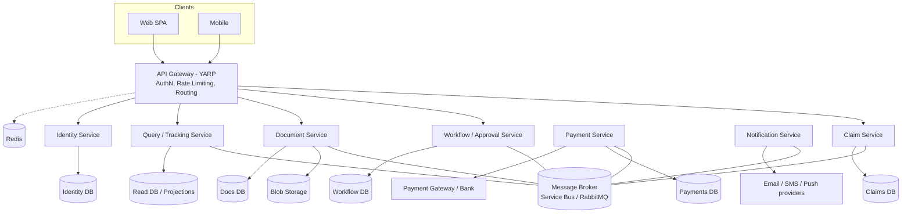
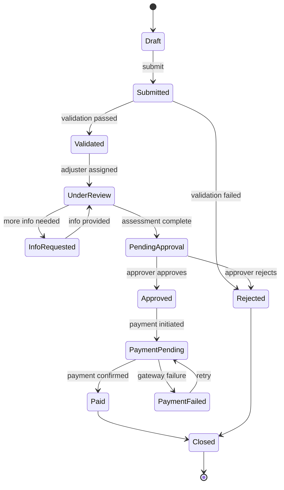
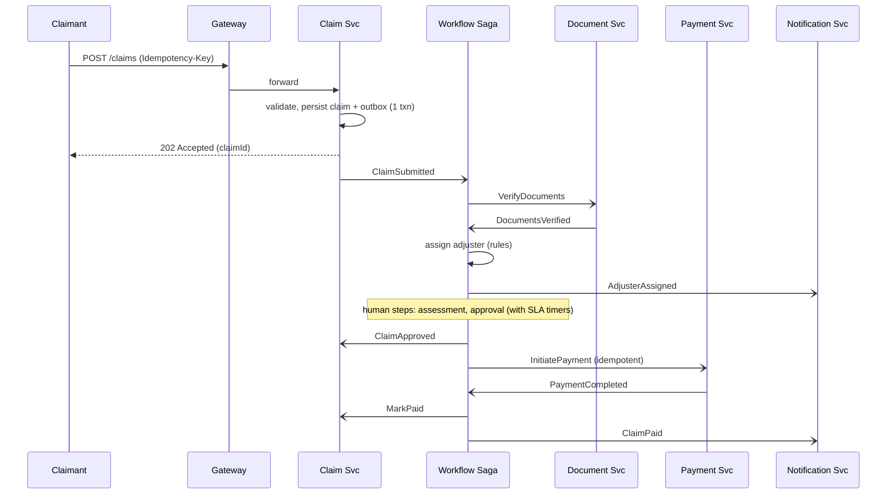

# E-Claim Platform: Architecture & Design

> **Author perspective:** Principal Architect
> **Stack:** ASP.NET Core 8, SQL Server, Azure Service Bus (or RabbitMQ), Redis, Azure Blob Storage
> **Repo style:** Monorepo, single root solution
> **Status:** Design (v1.0)

---

## 1. Problem Statement & Scope

Build an enterprise-grade **E-Claim** platform that lets claimants submit claims digitally, lets adjusters assess them, lets approvers decide, and pays out, with full traceability.

### In scope
- Claim submission (with documents), validation, tracking
- Adjuster assignment and assessment
- Multi-level approval workflow
- Payment initiation and reconciliation
- Notifications (email / SMS / push)
- Role-based access: **Admin, Claimant, Adjuster, Approver**
- Audit trail and reporting

### Out of scope (extension points)
- Fraud scoring (ML), OCR/AI document extraction, policy administration, multi-insurer tenancy. Each has a defined integration seam (see §14).

### Assumptions (to be validated with stakeholders)
| Item | Assumption |
|---|---|
| Volume | 50k claims/day, 5k concurrent users, peak 3x at month-end |
| Documents | 5 to 10 MB each, up to 10 per claim, retained 7 years |
| Availability | 99.9% for submission and tracking; payments may degrade gracefully |
| Consistency | Strong within a service, eventual across services |
| Compliance | PII protection, immutable audit, data retention policies |

---

## 2. Architectural Drivers

The design is shaped by these, in priority order:

1. **Correctness and auditability** over raw speed. Money and legal records are involved.
2. **Resilience to partial failure.** A claim must never be lost or double-paid.
3. **Independent scalability** of document handling and read traffic.
4. **Team autonomy and evolvability.** Clear bounded contexts, one owner per service.
5. **Operability.** Every request traceable end to end.

---

## 3. High-Level Architecture



### Bounded contexts and ownership

| Service | Owns | Key responsibilities |
|---|---|---|
| **Claim Service** | Claim aggregate | Submission, validation, lifecycle state machine |
| **Workflow/Approval Service** | Assignments, approval chains, SLA timers | Orchestrates the claim saga, routing rules |
| **Document Service** | Document metadata and blobs | Upload via pre-signed URL, virus scan, retention |
| **Payment Service** | Payouts, reconciliation | Idempotent payment execution, gateway integration |
| **Notification Service** | Templates, delivery log | Event-driven multi-channel notifications |
| **Identity Service** | Users, roles, permissions | OIDC/JWT issuing, RBAC policies |
| **Query/Tracking Service** | Read models | CQRS read side: tracking, dashboards, search |

**Rule:** no service reads another service's database. Integration happens only through APIs or events.

---

## 4. Key Architecture Decisions (ADRs)

### ADR-001: Microservices vs Modular Monolith
- **Decision:** Microservices, with a **monorepo** and one root solution.
- **Why:** Documents, payments, and reads have very different scaling and failure profiles; multiple teams will own contexts.
- **Trade-off:** Higher operational and consistency complexity. If the team were under 8 engineers or scale were modest, I would start as a **modular monolith** with the same module boundaries and extract later. The boundaries below are designed so that extraction is cheap.
- **Monorepo rationale:** atomic refactors, shared contracts and build tooling, a single CI pipeline with path-based triggers, and easiest to maintain.

### ADR-002: Orchestrated Saga (not choreography) for the claim lifecycle
- **Decision:** The Workflow service hosts a saga state machine (MassTransit).
- **Why:** The flow is long-running, has human steps, and needs central visibility, timeouts, and compensation.
- **Trade-off:** The orchestrator is a coordination hotspot. Mitigated by keeping it stateless apart from its persisted saga state, and scaling horizontally.

### ADR-003: Transactional Outbox + Inbox
- **Decision:** All events are written to an `Outbox` table in the same DB transaction as the state change; a relay publishes them. Consumers dedupe via an `Inbox`/processed-messages table.
- **Why:** Eliminates the dual-write problem; gives at-least-once delivery with effectively-once processing.

### ADR-004: CQRS only where it pays
- **Decision:** CQRS with separate read projections for **claim tracking, dashboards, and search**. Admin master-data CRUD stays plain CRUD.
- **Why:** Read traffic is much larger than write traffic and needs denormalized views. Applying CQRS everywhere would be over-engineering.

### ADR-005: SQL Server as the system of record
- **Decision:** SQL Server per service (database-per-service); EF Core for writes, Dapper for hot read paths.
- **Why:** Transactional integrity for financial data, a strong .NET toolchain, and team familiarity.
- **Trade-off:** A search or document store (e.g., Elasticsearch/Azure AI Search) may be added to the read side later for full-text queries.

### ADR-006: Documents bypass the API tier
- **Decision:** Clients upload directly to Blob Storage using short-lived pre-signed (SAS) URLs. The Document service records metadata and triggers a virus scan.
- **Why:** Keeps large payloads off the API servers and scales independently.

---

## 5. Claim Lifecycle (State Machine)



Transitions are enforced inside the **Claim aggregate** (DDD). Invalid transitions throw domain exceptions; they cannot be bypassed from the API layer. Every transition appends a row to `ClaimStatusHistory`.

---

## 6. Core Flow: Submit to Payout (Saga)



### Compensation and failure handling
| Failure | Handling |
|---|---|
| Document verification fails or times out | Move claim to `InfoRequested`, notify the claimant, SLA timer continues |
| Payment gateway error | Retry with backoff (Polly), then `PaymentFailed`, alert ops, manual retry path |
| Duplicate payment risk | Payment idempotency key = `ClaimId + PayoutVersion`, with a unique constraint |
| Consumer crash mid-processing | Message redelivered; inbox dedupe makes it safe |
| Poison message | Dead-letter queue with alerting and a replay tool |
| Approver SLA breach | Saga timeout, escalate to the next-level approver |

---

## 7. Cross-Cutting Concerns

### 7.1 Idempotency
- **API level:** `Idempotency-Key` header required on `POST /claims` and `POST /payments`. Stored in `IdempotencyKeys(Key, RequestHash, ResponseSnapshot, CreatedAt)` with a unique constraint. A replay returns the stored response; the same key with a different payload returns `422`.
- **Messaging level:** at-least-once delivery, with consumers idempotent via the Inbox table keyed on `MessageId`.
- **Payment level:** the gateway call itself carries the idempotency key.

### 7.2 Rate Limiting
- **Edge:** at the gateway, a per-user and per-IP sliding window using the built-in ASP.NET Core rate limiter, with **Redis** for distributed counters.
- **Tiers:** stricter limits on `POST /claims` and auth endpoints; looser on reads.
- **Response:** `429` with a `Retry-After` header.
- **Internal:** bulkheads and concurrency limits on expensive operations (e.g., document processing).

### 7.3 Pub/Sub
- Topics per bounded context (`claims.events`, `payments.events`, `documents.events`).
- Subscriptions per consumer, so Notification and Query services subscribe independently.
- **Event contracts** live in a shared `Contracts` project: versioned, additive-only changes, with `SchemaVersion` in the envelope.

### 7.4 Resilience
Polly policies: timeout, retry with jitter, circuit breaker, and bulkhead for service-to-service HTTP. Async messaging is preferred over sync calls wherever the user doesn't need an immediate answer.

### 7.5 Security
- OIDC/OAuth2, JWT access tokens; short-lived tokens with refresh.
- **RBAC + policy-based authorization:** an Adjuster sees only claims assigned to them; a Claimant sees only their own; an Approver is limited by approval limit (amount thresholds).
- PII: TLS in transit; TDE plus column-level encryption (Always Encrypted) for sensitive fields; data masking in logs.
- Documents: private containers, SAS URLs that expire in minutes, antivirus scan before use.
- Secrets in Key Vault; no secrets in config or the repo.
- OWASP controls: input validation, anti-forgery, strict CORS, security headers.

### 7.6 Audit and Compliance
- Append-only `AuditLog` (who, what, when, before/after, correlation ID).
- Claim status history is immutable.
- Retention and archival jobs per policy; legal hold support.

### 7.7 Observability
- **OpenTelemetry** traces, metrics, and logs; a **correlation ID** is propagated through HTTP headers and message headers.
- Structured logs (Serilog) to a central sink.
- Health checks (liveness/readiness); dashboards and alerts on SLOs (submission latency, saga stuck-time, DLQ depth, payment failure rate).

---

## 8. Data Design (SQL Server)

Each service owns its schema. Highlights:

### Claim Service
```sql
CREATE TABLE Claims (
    ClaimId        UNIQUEIDENTIFIER PRIMARY KEY,
    ClaimNumber    NVARCHAR(30)  NOT NULL UNIQUE,
    ClaimantId     UNIQUEIDENTIFIER NOT NULL,
    ClaimType      TINYINT NOT NULL,
    Status         TINYINT NOT NULL,
    ClaimedAmount  DECIMAL(18,2) NOT NULL,
    ApprovedAmount DECIMAL(18,2) NULL,
    Currency       CHAR(3) NOT NULL,
    IncidentDate   DATE NOT NULL,
    Description    NVARCHAR(2000) NULL,
    RowVersion     ROWVERSION,                  -- optimistic concurrency
    CreatedAt      DATETIME2 NOT NULL,
    UpdatedAt      DATETIME2 NOT NULL
);
CREATE INDEX IX_Claims_Status ON Claims(Status) INCLUDE (ClaimantId, CreatedAt);

CREATE TABLE ClaimStatusHistory (
    Id          BIGINT IDENTITY PRIMARY KEY,
    ClaimId     UNIQUEIDENTIFIER NOT NULL REFERENCES Claims(ClaimId),
    FromStatus  TINYINT NULL,
    ToStatus    TINYINT NOT NULL,
    ChangedBy   UNIQUEIDENTIFIER NOT NULL,
    Reason      NVARCHAR(500) NULL,
    ChangedAt   DATETIME2 NOT NULL
);

CREATE TABLE OutboxMessages (
    Id           UNIQUEIDENTIFIER PRIMARY KEY,
    Type         NVARCHAR(200) NOT NULL,
    Payload      NVARCHAR(MAX) NOT NULL,
    OccurredAt   DATETIME2 NOT NULL,
    ProcessedAt  DATETIME2 NULL
);
CREATE INDEX IX_Outbox_Unprocessed ON OutboxMessages(ProcessedAt) WHERE ProcessedAt IS NULL;

CREATE TABLE IdempotencyKeys (
    [Key]            NVARCHAR(100) PRIMARY KEY,
    RequestHash      CHAR(64) NOT NULL,
    ResponseSnapshot NVARCHAR(MAX) NULL,
    CreatedAt        DATETIME2 NOT NULL
);
```

### Workflow Service
`ClaimSagaState`, `ClaimAssignments`, `ApprovalSteps` (level, approver, decision, decidedAt), `ApprovalRules` (amount thresholds and claim types mapped to levels), `SlaTimers`.

### Document Service
`Documents` (DocumentId, ClaimId, BlobUri, ContentType, SizeBytes, Checksum, ScanStatus, UploadedBy, UploadedAt).

### Payment Service
`Payments` (PaymentId, ClaimId, Amount, Status, IdempotencyKey UNIQUE, GatewayRef, Attempts), `PaymentAttempts`, `ReconciliationRecords`.

### Query Service (read side)
Denormalized `ClaimTrackingView` (claim, current status, adjuster, last activity, SLA due) and `ClaimDashboardStats`, rebuilt from events and **rebuildable by replay**.

**Operational notes:** use `READ_COMMITTED_SNAPSHOT`; partition or archive closed claims older than N years; indexes on the access paths above; no cross-service foreign keys.

---

## 9. API Surface (representative)

**Claim Service**
| Method | Route | Role | Notes |
|---|---|---|---|
| POST | `/api/claims` | Claimant | Idempotency-Key required, returns 202 |
| GET | `/api/claims/{id}` | Claimant/Adjuster/Approver | Policy-scoped |
| PUT | `/api/claims/{id}` | Claimant | Draft/InfoRequested only |
| POST | `/api/claims/{id}/submit` | Claimant | Draft to Submitted |
| POST | `/api/claims/{id}/withdraw` | Claimant | |

**Workflow Service**
| Method | Route | Role |
|---|---|---|
| POST | `/api/workflow/claims/{id}/assign` | Admin |
| POST | `/api/workflow/claims/{id}/assessment` | Adjuster |
| POST | `/api/workflow/claims/{id}/decision` | Approver |
| POST | `/api/workflow/claims/{id}/request-info` | Adjuster |

**Document Service**
| Method | Route | Notes |
|---|---|---|
| POST | `/api/documents/upload-url` | Returns a short-lived SAS URL |
| POST | `/api/documents/{id}/confirm` | Triggers scan |
| GET | `/api/documents/{id}/download-url` | Authorized, expiring |

**Query Service**
| Method | Route |
|---|---|
| GET | `/api/tracking/claims?status=&from=&to=&page=` |
| GET | `/api/tracking/claims/{id}/timeline` |
| GET | `/api/dashboard/summary` |

**Payment / Identity / Notification** follow the same conventions (`/api/payments`, `/api/auth/token`, `/api/users`, `/api/notifications/preferences`).

**API conventions:** versioned (`/v1`), RFC 7807 problem details, cursor or page-based pagination, ETag/If-Match for concurrency, correlation ID in the response headers.

---

## 10. Monorepo Structure

```
eclaim/
├─ EClaim.sln
├─ build/                      # CI templates, scripts
├─ deploy/                     # Helm charts / Bicep / docker-compose
├─ docs/                       # ADRs, diagrams, runbooks
├─ src/
│  ├─ BuildingBlocks/
│  │  ├─ EClaim.Contracts/        # Integration events, shared DTO contracts
│  │  ├─ EClaim.Messaging/        # Outbox/Inbox, MassTransit setup
│  │  ├─ EClaim.Observability/    # OTel, Serilog, correlation
│  │  └─ EClaim.Security/         # Auth policies, claims helpers
│  ├─ Gateway/EClaim.Gateway/
│  ├─ Services/
│  │  ├─ Claims/
│  │  │  ├─ EClaim.Claims.Api/
│  │  │  ├─ EClaim.Claims.Application/   # Commands, handlers, validators
│  │  │  ├─ EClaim.Claims.Domain/        # Aggregates, state machine
│  │  │  └─ EClaim.Claims.Infrastructure/# EF Core, outbox, repos
│  │  ├─ Workflow/   (same four-layer layout)
│  │  ├─ Documents/
│  │  ├─ Payments/
│  │  ├─ Notifications/
│  │  ├─ Identity/
│  │  └─ Query/
│  └─ Web/EClaim.Web/             # SPA (Angular/React) or Blazor
└─ tests/
   ├─ *.UnitTests/
   ├─ *.IntegrationTests/        # Testcontainers (SQL Server, broker)
   ├─ EClaim.ContractTests/      # Consumer-driven contract tests
   └─ EClaim.E2E/
```

**Layering rule:** Domain depends on nothing; Application depends on Domain; Infrastructure and Api depend on Application. Enforced with architecture tests (NetArchTest).

---

## 11. Non-Functional Strategy

| Concern | Approach |
|---|---|
| **Scalability** | Stateless services on Kubernetes with HPA; scale Documents and Query independently; consumers scale via competing-consumer pattern |
| **Availability** | Multi-AZ, health-probed rollouts, a degraded mode where claims can still be submitted if Payment is down (the saga holds the work) |
| **Performance** | Redis cache for reference data; read projections; async processing; Dapper on hot reads; p95 target under 300 ms for reads |
| **Consistency** | Strong inside an aggregate, eventual across services; UI shows explicit "processing" states |
| **DR** | Geo-redundant backups, RPO about 15 min, RTO about 1 hr; the runbook is tested |
| **Cost** | Right-size; archive cold claims and documents to a cool tier |

---

## 12. Testing Strategy

- **Unit:** domain rules and state machine (the fastest feedback).
- **Integration:** Testcontainers with real SQL Server and broker.
- **Contract:** consumer-driven tests for events and APIs, so teams can release independently.
- **Saga tests:** MassTransit test harness covering happy path, timeouts, and compensation.
- **Load:** k6 or NBomber against the peak profile; chaos tests for broker and DB failure.
- **Security:** SAST/DAST, dependency scanning, authorization matrix tests per role.

---

## 13. Delivery & Deployment

- **CI:** path-filtered builds per service in the monorepo; build, test, scan, containerize.
- **CD:** GitOps; progressive delivery (canary or blue-green); automated rollback on SLO regression.
- **DB migrations:** forward-only, backward-compatible (expand/contract) so rolling deployments are safe.
- **Config:** environment-specific via Key Vault and App Configuration; feature flags for risky changes.

---

## 14. Risks & Mitigations

| Risk | Mitigation |
|---|---|
| Distributed-system complexity outpaces team maturity | Strong platform building blocks, templates, and documentation; consider the modular-monolith start (ADR-001) |
| Event schema drift breaks consumers | Versioned contracts, contract tests in CI |
| Saga stuck or orphaned instances | Timeouts, stuck-saga dashboards and alerts, an admin "nudge" tool |
| Read-model lag confuses users | Show last-updated time; read-your-writes via a version token for the submitter |
| Duplicate or lost payments | Idempotency end to end, reconciliation job, and manual-review queue |
| PII leak | Encryption, least privilege, masked logs, access audits |

---

## 15. Evolution Roadmap

1. **MVP:** submit, assign, approve or reject, track, notify.
2. **Phase 2:** payments and reconciliation, SLA escalations, dashboards.
3. **Phase 3:** fraud-scoring service (a subscriber of `ClaimSubmitted`), OCR/AI document extraction.
4. **Phase 4:** multi-tenant support for multiple insurers, event sourcing on the Claim aggregate if regulatory audit demands full replay.

---

## 16. Interview Summary (30-second pitch)

> "I'd model E-Claim as bounded contexts: Claims, Workflow, Documents, Payments, Notifications, Identity, and a CQRS Query side. They're connected by a broker with the transactional outbox for reliable events, and the claim lifecycle is an orchestrated saga with timeouts and compensation. Idempotency is enforced at the API, message, and payment layers. The gateway handles auth and rate limiting. SQL Server is the system of record per service. I'd start in a monorepo, and honestly I'd weigh a modular monolith first if the team or scale doesn't yet justify microservices, because the context boundaries are the same either way. The things I'd defend hardest are correctness of money movement, auditability, and operability."
