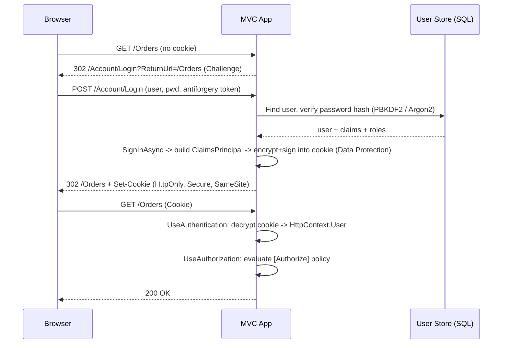
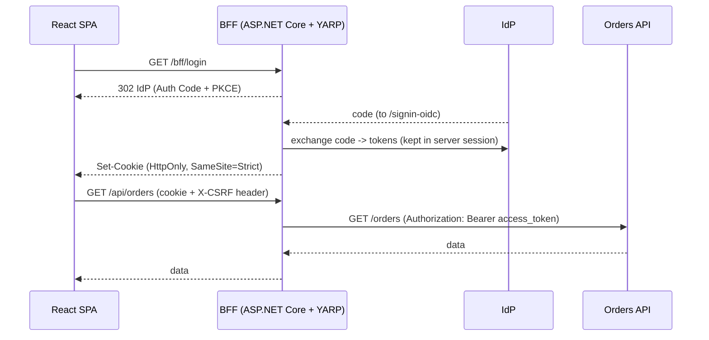
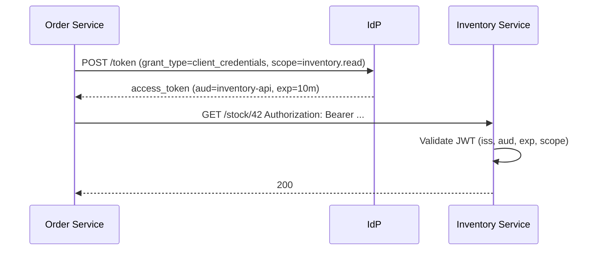

# Senior / Principal Architect Interview Guide
## MVC Authentication Flow + Microservice Service-to-Service Communication

> **Audience:** Candidate for Principal / Solution Architect role.
> **Answer persona:** Architect with 25+ years in .NET, React and microservices.
> **Stack assumed:** ASP.NET Core MVC (.NET 8+), React SPA, ASP.NET Core Web APIs, OIDC IdP (Entra ID / Duende IdentityServer / Keycloak), RabbitMQ / Azure Service Bus, SQL Server.

How to use this document: each question has **the question**, **what the interviewer is really testing**, a **model senior answer**, and **code / diagram** where useful. A senior answer never stops at "how" - it always covers **why, trade-offs, failure modes and operations**.

---

## Table of Contents

**Part A - MVC Authentication Flow**
1. [Walk me through the authentication flow of an MVC app](#a1)
2. [Cookie vs JWT for MVC](#a2)
3. [OIDC Authorization Code + PKCE in MVC](#a3)
4. [React SPA + ASP.NET Core: BFF pattern](#a4)
5. [Token lifetime, refresh, sliding expiry](#a5)
6. [Authorization: roles, claims, policies, resource-based](#a6)
7. [Securing cookies: CSRF, XSS, fixation](#a7)
8. [MFA, lockout, password policy, ASP.NET Core Identity](#a8)
9. [Logout and single sign-out](#a9)
10. [Scaling out: Data Protection keys and sessions](#a10)
11. [External IdP federation and multi-tenancy](#a11)
12. [Production troubleshooting scenarios](#a12)

**Part B - Service-to-Service Communication**
13. [Sync vs async: how do you choose](#b1)
14. [Authenticating service-to-service calls](#b2)
15. [Client Credentials with token caching (code)](#b3)
16. [Propagating user identity: On-Behalf-Of / Token Exchange](#b4)
17. [mTLS and service mesh](#b5)
18. [REST vs gRPC](#b6)
19. [Messaging: events, commands, MassTransit](#b7)
20. [Resilience: retries, timeouts, circuit breaker, bulkhead](#b8)
21. [Consistency: Outbox, Saga, Idempotency](#b9)
22. [API Gateway / YARP, service discovery](#b10)
23. [Observability: correlation, tracing](#b11)
24. [Versioning and contract testing](#b12)
25. [Scenario-based design questions](#b13)

**Appendix** - [Cheat sheet](#cheat) | [Red flags](#red)

---

# Part A - MVC Authentication Flow

<a id="a1"></a>
## Q1. Walk me through the authentication flow of an ASP.NET Core MVC application.

**Interviewer is testing:** Do you understand the middleware pipeline, schemes, handlers, and the difference between authentication and authorization - not just `[Authorize]`.

**Model answer**

Authentication in ASP.NET Core is **scheme-based**. A *scheme* = a name + an *authentication handler*. Three operations matter:

| Operation | Meaning | Typical trigger |
|---|---|---|
| **Authenticate** | Read the request, build a `ClaimsPrincipal` | `UseAuthentication()` middleware on every request |
| **Challenge** | Tell the client "you must sign in" | `[Authorize]` fails for anonymous user (401) |
| **Forbid** | Signed in but not allowed | Policy fails (403) |

**Cookie-based login flow (classic MVC with ASP.NET Core Identity):**



**Pipeline order matters:**

```csharp
app.UseHttpsRedirection();
app.UseStaticFiles();
app.UseRouting();
app.UseAuthentication();   // who are you?
app.UseAuthorization();    // what can you do?
app.MapControllerRoute(...);
```

Putting `UseAuthorization` before `UseAuthentication` is a classic bug - the user is always anonymous.

**Senior add-on:** In enterprise systems I do **not** let each MVC app own credentials. Credentials live in a central IdP and MVC becomes an OIDC *relying party* (see Q3). Local Identity is for small/standalone systems only.

---

<a id="a2"></a>
## Q2. Cookie vs JWT for an MVC application - which one and why?

**Model answer**

| Aspect | Cookie session | JWT bearer |
|---|---|---|
| Best for | Server-rendered MVC, BFF | APIs, service-to-service, mobile |
| Storage | Browser cookie (HttpOnly) | Wherever the client puts it (risky in `localStorage`) |
| Revocation | Easy (server-side ticket store / short expiry) | Hard (valid until expiry unless introspection / deny list) |
| XSS exposure | Token not readable by JS | Token readable if stored in JS |
| CSRF exposure | **Yes** - need antiforgery + SameSite | No (not sent automatically) |
| Size | Can grow large (claims) - use `SessionStore` | Grows with claims too |
| Scale-out | Needs shared Data Protection keys | Stateless validation (just keys/JWKS) |

**Decision:** For an MVC app *the browser talks to*, use **cookies**. For *API calls the app makes*, use **access tokens**. In most real designs the answer is **both**: cookie between browser and web app, bearer tokens between web app and APIs. That is exactly what OIDC + cookie hybrid does.

**Anti-pattern to call out:** "We store JWT in localStorage for the React app." Any XSS (including a compromised npm dependency) exfiltrates the token. Prefer BFF (Q4).

---

<a id="a3"></a>
## Q3. Implement OIDC Authorization Code flow with PKCE in an MVC app.

**Interviewer is testing:** Modern protocol knowledge. Implicit flow and hybrid flow are legacy. Authorization Code + PKCE is the current best practice (OAuth 2.1 direction).

```mermaid
sequenceDiagram
    participant B as Browser
    participant M as MVC (confidential client)
    participant I as IdP (Entra / Duende)
    participant A as Orders API
    B->>M: GET /Orders
    M-->>B: 302 to IdP /authorize?response_type=code&code_challenge=...&state=...&nonce=...
    B->>I: Authorize request, user signs in (+MFA)
    I-->>B: 302 to /signin-oidc?code=XYZ&state=...
    B->>M: GET /signin-oidc?code=XYZ
    M->>I: POST /token (code, code_verifier, client_secret/cert)  [back-channel]
    I-->>M: id_token, access_token, refresh_token
    M->>M: Validate id_token (sig, iss, aud, exp, nonce); create cookie principal; save tokens
    M-->>B: 302 /Orders + auth cookie
    M->>A: GET /api/orders  Authorization: Bearer <access_token>
```

**Configuration:**

```csharp
builder.Services
    .AddAuthentication(options =>
    {
        options.DefaultScheme = CookieAuthenticationDefaults.AuthenticationScheme;
        options.DefaultChallengeScheme = OpenIdConnectDefaults.AuthenticationScheme;
    })
    .AddCookie(options =>
    {
        options.Cookie.Name = "__Host-shop-auth";
        options.Cookie.HttpOnly = true;
        options.Cookie.SecurePolicy = CookieSecurePolicy.Always;
        options.Cookie.SameSite = SameSiteMode.Lax;   // Lax needed for the IdP redirect back
        options.SlidingExpiration = true;
        options.ExpireTimeSpan = TimeSpan.FromMinutes(30);
    })
    .AddOpenIdConnect(options =>
    {
        options.Authority = builder.Configuration["Oidc:Authority"];
        options.ClientId = builder.Configuration["Oidc:ClientId"];
        options.ClientSecret = builder.Configuration["Oidc:ClientSecret"]; // from Key Vault, never appsettings in prod
        options.ResponseType = OpenIdConnectResponseType.Code;
        options.UsePkce = true;
        options.SaveTokens = true;                      // store tokens in the auth properties (cookie/ticket store)
        options.GetClaimsFromUserInfoEndpoint = true;
        options.MapInboundClaims = false;               // keep original claim names ("sub", "role")
        options.Scope.Clear();
        options.Scope.Add("openid");
        options.Scope.Add("profile");
        options.Scope.Add("offline_access");            // refresh token
        options.Scope.Add("orders.read");
        options.TokenValidationParameters = new TokenValidationParameters
        {
            NameClaimType = "name",
            RoleClaimType = "role",
            ValidateIssuer = true,
            ClockSkew = TimeSpan.FromMinutes(1)
        };
    });
```

**Points a senior must mention**
- `state` protects against CSRF on the callback; `nonce` binds the id_token to the session (replay protection); PKCE protects the code from interception.
- Validate `iss`, `aud`, `exp`, signature (JWKS rotation handled by the metadata endpoint).
- Prefer **certificate / private_key_jwt** client authentication over shared secrets for high-security systems.
- `SaveTokens = true` puts tokens in the cookie - cookie gets big. For many claims/tokens use a **server-side `ITicketStore`** (Redis) so the cookie only contains a session key.

---

<a id="a4"></a>
## Q4. We have a React SPA and ASP.NET Core APIs. How do you authenticate the SPA securely?

**Model answer - three options, ranked:**

1. **BFF (Backend-for-Frontend) with cookies - my default for browser apps.**
   The SPA never sees tokens. A thin ASP.NET Core host performs OIDC, keeps tokens server-side, and proxies API calls (YARP / Duende.BFF) attaching the access token.
2. **SPA as public client with Auth Code + PKCE (e.g. MSAL.js / oidc-client-ts).**
   Acceptable for low/medium risk; tokens in memory (not localStorage); refresh via rotating refresh tokens. Still exposed to XSS.
3. **Implicit flow** - deprecated, never.



**BFF essentials in code:**

```csharp
// Program.cs (BFF)
builder.Services.AddReverseProxy()
    .LoadFromConfig(builder.Configuration.GetSection("ReverseProxy"))
    .AddTransforms(ctx =>
    {
        ctx.AddRequestTransform(async t =>
        {
            var token = await t.HttpContext.GetTokenAsync("access_token");
            if (!string.IsNullOrEmpty(token))
                t.ProxyRequest.Headers.Authorization = new("Bearer", token);
        });
    });

app.MapGet("/bff/user", (ClaimsPrincipal user) =>
    user.Identity?.IsAuthenticated == true
        ? Results.Ok(user.Claims.Select(c => new { c.Type, c.Value }))
        : Results.Unauthorized());

app.MapGet("/bff/login", () => Results.Challenge(
    new AuthenticationProperties { RedirectUri = "/" }));
app.MapReverseProxy().RequireAuthorization();
```

**React side:**

```ts
// Always send cookies; add a custom header the BFF requires (CSRF defence for APIs)
export async function api<T>(url: string, init: RequestInit = {}): Promise<T> {
  const res = await fetch(url, {
    ...init,
    credentials: "include",
    headers: { "X-CSRF": "1", "Content-Type": "application/json", ...(init.headers ?? {}) },
  });
  if (res.status === 401) { window.location.href = "/bff/login"; throw new Error("unauthenticated"); }
  if (!res.ok) throw new Error(`HTTP ${res.status}`);
  return res.json();
}
```

**Trade-off to state:** BFF adds a hop and a stateful component, but removes token handling from the browser and simplifies CORS (same site). For a regulated domain (banking/insurance) this is worth it.

---

<a id="a5"></a>
## Q5. How do you handle token expiry, refresh and sliding sessions?

**Model answer**

Separate **three lifetimes**:
| Lifetime | Typical value | Purpose |
|---|---|---|
| Access token | 5-15 min | Limits blast radius of leak |
| Refresh token | Hours-days, **rotating, one-time use** | Gets new access tokens without re-login |
| Cookie / session | 20-60 min sliding, with absolute cap (e.g. 8-12 h) | UX vs. security |

**Refreshing the access token in MVC when it is about to expire:**

```csharp
public class TokenRefreshEvents : CookieAuthenticationEvents
{
    private readonly IHttpClientFactory _http;
    private readonly IConfiguration _cfg;
    public TokenRefreshEvents(IHttpClientFactory http, IConfiguration cfg) { _http = http; _cfg = cfg; }

    public override async Task ValidatePrincipal(CookieValidatePrincipalContext ctx)
    {
        var expiresAt = ctx.Properties.GetTokenValue("expires_at");
        if (!DateTimeOffset.TryParse(expiresAt, out var exp) || exp > DateTimeOffset.UtcNow.AddMinutes(2))
            return;

        var refresh = ctx.Properties.GetTokenValue("refresh_token");
        var client = _http.CreateClient("idp");
        var resp = await client.PostAsync("connect/token", new FormUrlEncodedContent(new Dictionary<string,string>
        {
            ["grant_type"] = "refresh_token",
            ["refresh_token"] = refresh!,
            ["client_id"] = _cfg["Oidc:ClientId"]!,
            ["client_secret"] = _cfg["Oidc:ClientSecret"]!
        }));

        if (!resp.IsSuccessStatusCode)
        {
            ctx.RejectPrincipal();                       // forces re-login
            await ctx.HttpContext.SignOutAsync();
            return;
        }

        var json = await resp.Content.ReadFromJsonAsync<TokenResponse>();
        ctx.Properties.UpdateTokenValue("access_token", json!.access_token);
        ctx.Properties.UpdateTokenValue("refresh_token", json.refresh_token);
        ctx.Properties.UpdateTokenValue("expires_at", DateTimeOffset.UtcNow.AddSeconds(json.expires_in).ToString("o"));
        ctx.ShouldRenew = true;                          // re-issue cookie
    }
}
public record TokenResponse(string access_token, string refresh_token, int expires_in);
```

**Senior details**
- Refresh-token **rotation + reuse detection**: if an old refresh token is replayed, revoke the whole family.
- Concurrency: two parallel requests may both try to refresh - use a lock/`SemaphoreSlim` per session or a library (Duende.AccessTokenManagement) that handles it.
- Absolute session timeout prevents "sliding forever".

---

<a id="a6"></a>
## Q6. Authentication is done. How do you design authorization?

**Model answer - layered:**

1. **Coarse:** Roles (`[Authorize(Roles = "Admin")]`) - fine for few, stable roles.
2. **Claims / policy-based:** business rules as policies. Preferred.
3. **Resource-based:** decision depends on the data (e.g. "adjuster can edit only claims assigned to their region").
4. **Externalised (PDP/PEP):** OPA, Cerbos, Azure AD app roles + permission service when rules are complex or shared across services.

```csharp
builder.Services.AddAuthorization(o =>
{
    o.AddPolicy("CanApproveClaims", p => p
        .RequireAuthenticatedUser()
        // OAuth scope is commonly represented as a space-delimited claim.
        .RequireAssertion(ctx => ctx.User.FindAll("scope")
            .SelectMany(c => c.Value.Split(' ', StringSplitOptions.RemoveEmptyEntries))
            .Contains("claims.approve", StringComparer.Ordinal))
        .RequireAssertion(ctx => ctx.User.HasClaim("amr", "mfa")));   // step-up: require MFA
    o.FallbackPolicy = new AuthorizationPolicyBuilder()               // secure by default
        .RequireAuthenticatedUser().Build();
});

// Resource-based
public class ClaimOwnerRequirement : IAuthorizationRequirement { }

public class ClaimOwnerHandler : AuthorizationHandler<ClaimOwnerRequirement, Claim>
{
    protected override Task HandleRequirementAsync(
        AuthorizationHandlerContext ctx, ClaimOwnerRequirement req, Claim resource)
    {
        var region = ctx.User.FindFirst("region")?.Value;
        if (region != null && region == resource.Region) ctx.Succeed(req);
        return Task.CompletedTask;
    }
}

// Controller
[HttpPost("{id}/approve")]
public async Task<IActionResult> Approve(int id)
{
    var claim = await _repo.GetAsync(id);
    var result = await _auth.AuthorizeAsync(User, claim, "CanApproveClaims");
    if (!result.Succeeded) return Forbid();
    ...
}
```

**Key sentences to say:** "Use a **fallback policy** so new endpoints are secure by default. Authorization is enforced **at every service**, not only at the gateway - defence in depth."

React note: hiding a button is UX, not security. The API must enforce.

---

<a id="a7"></a>
## Q7. How do you protect the cookie-authenticated MVC app from CSRF, XSS and session attacks?

| Threat | Mitigation |
|---|---|
| **CSRF** | `[ValidateAntiForgeryToken]` / global `AutoValidateAntiforgeryTokenAttribute`; `SameSite=Lax/Strict`; custom header check for AJAX |
| **XSS** | Razor auto-encoding; strict **CSP** (no inline script, nonce-based); never `Html.Raw` on user input; sanitise rich text |
| **Session fixation** | Issue a new cookie on login (ASP.NET Core does on `SignInAsync`); invalidate old session |
| **Cookie theft** | `HttpOnly`, `Secure`, `__Host-` prefix, short lifetime, bind to IP/UA only if UX allows |
| **Clickjacking** | `X-Frame-Options: DENY` / CSP `frame-ancestors 'none'` |
| **Open redirect** on `ReturnUrl` | `Url.IsLocalUrl(returnUrl)` check |
| **Brute force** | Lockout, rate limiting (`AddRateLimiter`), CAPTCHA after N failures |
| **Credential stuffing** | MFA, breached-password check (HIBP k-anonymity), IP reputation |
| **Transport** | HTTPS everywhere, HSTS, TLS 1.2+ |

```csharp
builder.Services.AddControllersWithViews(o =>
    o.Filters.Add(new AutoValidateAntiforgeryTokenAttribute()));

builder.Services.AddRateLimiter(o => o.AddPolicy("login", ctx =>
    RateLimitPartition.GetFixedWindowLimiter(
        ctx.Connection.RemoteIpAddress?.ToString() ?? "anon",
        _ => new FixedWindowRateLimiterOptions { PermitLimit = 5, Window = TimeSpan.FromMinutes(1) })));

app.Use(async (ctx, next) =>
{
    ctx.Response.Headers["Content-Security-Policy"] =
        "default-src 'self'; script-src 'self'; object-src 'none'; frame-ancestors 'none'";
    ctx.Response.Headers["X-Content-Type-Options"] = "nosniff";
    await next();
});
```

---

<a id="a8"></a>
## Q8. How would you implement MFA, lockout and password policy with ASP.NET Core Identity? When would you not use it?

**Model answer**

```csharp
builder.Services.AddIdentity<AppUser, IdentityRole>(o =>
{
    o.Password.RequiredLength = 12;
    o.Password.RequireNonAlphanumeric = false;      // NIST 800-63B: length > composition rules
    o.Lockout.MaxFailedAccessAttempts = 5;
    o.Lockout.DefaultLockoutTimeSpan = TimeSpan.FromMinutes(15);
    o.SignIn.RequireConfirmedEmail = true;
    o.Tokens.AuthenticatorTokenProvider = TokenOptions.DefaultAuthenticatorProvider;
})
.AddEntityFrameworkStores<AppDbContext>()
.AddDefaultTokenProviders();
```

Login with lockout + 2FA:

```csharp
var result = await _signIn.PasswordSignInAsync(model.Email, model.Password, model.RememberMe, lockoutOnFailure: true);
if (result.RequiresTwoFactor) return RedirectToAction("VerifyCode");
if (result.IsLockedOut)       return View("Lockout");
```

**Passwords:** ASP.NET Core Identity uses PBKDF2 with a per-user salt and high iteration count by default; I would migrate to Argon2id when policy requires.

**When NOT to use Identity directly:** many apps/SSO needed, federation, social/enterprise login, passwordless/passkeys (WebAuthn), compliance auditing. Then use a dedicated IdP (Entra ID, Keycloak, Duende, Auth0) and treat apps as OIDC clients. "Don't build an IdP in every app."

---

<a id="a9"></a>
## Q9. How do you implement logout and single sign-out?

**Model answer**

Logout has **three layers**: local cookie, IdP session, and other apps' sessions.

```csharp
[HttpPost]
[ValidateAntiForgeryToken]
public IActionResult Logout() =>
    SignOut(new AuthenticationProperties { RedirectUri = "/" },
            CookieAuthenticationDefaults.AuthenticationScheme,
            OpenIdConnectDefaults.AuthenticationScheme);   // triggers RP-initiated logout at IdP
```

- **Front-channel logout:** IdP renders iframes calling each app's logout URL (breaks with third-party cookie blocking).
- **Back-channel logout (recommended):** IdP POSTs a signed `logout_token` to each app; app invalidates the session by `sid`. Needs a **server-side session store** (Redis) to look up and kill sessions.
- Also revoke refresh tokens at the IdP; access tokens remain valid until expiry (hence short lifetimes).
- Logout must be **POST with antiforgery**, otherwise any `` can sign users out.

---

<a id="a10"></a>
## Q10. The app runs on 6 pods behind a load balancer. Users get randomly logged out. Why?

**Classic cause:** each instance generates its **own Data Protection keys**, so a cookie encrypted by pod A cannot be decrypted by pod B.

**Fix:** persist and share keys, protect them at rest, set an application name.

```csharp
builder.Services.AddDataProtection()
    .SetApplicationName("shop-web")
    .PersistKeysToStackExchangeRedis(ConnectionMultiplexer.Connect(redisConn), "DataProtection-Keys")
    .ProtectKeysWithAzureKeyVault(new Uri(kvKeyUri), new DefaultAzureCredential());
```

Other scale-out items:
- Anti-forgery tokens use the same Data Protection keys.
- In-memory `Session` / `TempData` will break → distributed cache (Redis) or cookie TempData.
- Large cookies (tokens inside) → `ITicketStore` backed by Redis.
- Sticky sessions are a crutch, not a solution; design stateless-with-shared-store.
- Behind a proxy: `UseForwardedHeaders` so the app sees `https` (otherwise redirect URIs are `http://` and OIDC fails).

---

<a id="a11"></a>
## Q11. How do you support multiple identity providers and multi-tenant login?

**Patterns**

| Need | Approach |
|---|---|
| Employees via corporate AD, customers via social/email | IdP as **broker** (Entra External ID, Keycloak, Duende) - app trusts one IdP only |
| Each tenant has its own IdP (B2B SaaS) | Tenant-resolved authority: dynamic OIDC options per tenant; store issuer, client id, secret per tenant |
| Tenant isolation in tokens | `tid`/`tenant_id` claim; every query filtered by tenant; validate `iss` per tenant |

Dynamic scheme per tenant (sketch):

```csharp
public class TenantOidcOptionsMonitor : IOptionsMonitor<OpenIdConnectOptions> { /* resolve tenant from host/path, load config, cache */ }
```

**Risks to call out:** issuer confusion (accepting tokens from any tenant), claim collisions between IdPs, account linking/takeover when emails match across IdPs - link on `(issuer, sub)`, never on email alone.

---

<a id="a12"></a>
## Q12. Troubleshooting scenarios (rapid-fire)

| Symptom | Likely cause | Fix |
|---|---|---|
| Infinite redirect loop after login | Cookie not persisted: `SameSite=None` without `Secure`, or http/https mismatch behind proxy | Forwarded headers, `Secure` cookies, correct redirect URI |
| `Correlation failed` on `/signin-oidc` | Correlation/nonce cookie lost (SameSite, multi-domain, load balancer) | `SameSite=None; Secure` for the OIDC cookies, check domain, shared DP keys |
| `IDX10205: Issuer validation failed` | Wrong authority/tenant or v1 vs v2 endpoint issuer | Align `Authority` and `ValidIssuer` |
| 401 from API though token looks valid | Wrong `aud`, clock skew, key rotation not refreshed, missing `UseAuthentication` | Check `aud`, `ClockSkew`, JWKS caching |
| Claims missing (`role` not present) | `MapInboundClaims` renamed them, or IdP doesn't emit in id_token | Set `MapInboundClaims=false`, request claims via scope/UserInfo |
| Cookie > 4 KB, user randomly logged out | Tokens/claims too large, browser drops cookie | `ITicketStore`, reduce claims, don't store id_token |
| Works locally, fails in prod | HTTPS terminated at LB, redirect URI registered with http | `ForwardedHeaders`, register https URI |

---

# Part B - Microservice Service-to-Service Communication

<a id="b1"></a>
## Q13. Synchronous vs asynchronous communication: how do you choose?

**Rule of thumb:** *Ask for data synchronously, announce facts asynchronously.*

| Need | Style | Tech |
|---|---|---|
| Caller needs the answer **now** to proceed (price check, validation, query) | **Sync request/response** | REST (HTTP/JSON), gRPC |
| Tell others something **happened**, fire-and-forget, many consumers | **Async event (pub/sub)** | Azure Service Bus topics, RabbitMQ exchanges, Kafka |
| Ask another service to **do work**, caller doesn't wait | **Async command (queue)** | Service Bus queue, RabbitMQ queue |
| Long-running business process across services | **Saga / workflow** | MassTransit state machine, Durable Functions, Temporal |
| High-volume streaming / replay / analytics | **Log-based streaming** | Kafka / Event Hubs |

**Trade-offs to articulate**

- Sync chains multiply latency and **multiply failure probability**: if 5 services each have 99.9% availability in series, composite ≈ 99.5%. Temporal coupling is the enemy.
- Async gives autonomy and buffering but brings **eventual consistency, duplicate delivery, ordering and debugging complexity**.
- Don't build a "distributed monolith": if a service cannot work when another is down, the boundary is probably wrong.

**Example - Insurance Claim system**

```
Claims UI (React) -> BFF -> Claims API
                              |-- (sync gRPC)  -> Policy Service   : "is policy active, coverage?"  (needs answer now)
                              |-- (async event) -> ClaimSubmitted   -> Fraud Service, Notification Service, Audit Service
                              |-- (async command)-> AssessClaim     -> Assessment Service (queue)
                              '-- (saga)        -> Payment approval across Claims, Finance, Ledger
```

---

<a id="b2"></a>
## Q14. How do you authenticate and authorize service-to-service calls?

**Model answer - there are three identities in play:**
1. **The calling service's identity** (workload identity)
2. **The end user's identity** (if the call is on behalf of a user)
3. **Network-level identity** (mTLS)

| Scenario | Mechanism |
|---|---|
| Background job / service acting as itself (no user) | **OAuth2 Client Credentials** (`scope`/app roles), or managed identity / workload identity (no secrets) |
| Service acting for the user | **User token propagation** *or* **On-Behalf-Of / Token Exchange (RFC 8693)** |
| Defence in depth inside cluster | **mTLS** via service mesh (Istio/Linkerd) or Dapr; Kubernetes NetworkPolicies |
| Async messages | Broker-level auth (SAS / RBAC / TLS) plus verifiable message metadata; re-authorize at the consumer when user context matters |

**Golden rules**
- Zero-trust: **never trust a request because it comes from inside the network.** Every service validates a token.
- **Least privilege:** audience-restricted tokens (`aud=orders-api`), narrow scopes per service.
- **Don't pass the user's original access token blindly** across many hops (token replay, confused deputy, wrong audience). Exchange it for one scoped to the next service.
- Prefer **managed identities / workload identity federation** over client secrets in config. Where secrets are needed: Key Vault + rotation.

---

<a id="b3"></a>
## Q15. Show Client Credentials between two services with token caching.



**Caller side - delegating handler with cache:**

```csharp
public sealed class ClientCredentialsHandler : DelegatingHandler
{
    private readonly IHttpClientFactory _factory;
    private readonly IMemoryCache _cache;
    private readonly ClientCredentialsOptions _opt;
    private static readonly SemaphoreSlim _gate = new(1, 1);

    public ClientCredentialsHandler(IHttpClientFactory f, IMemoryCache c, IOptions<ClientCredentialsOptions> o)
        => (_factory, _cache, _opt) = (f, c, o.Value);

    protected override async Task<HttpResponseMessage> SendAsync(HttpRequestMessage request, CancellationToken ct)
    {
        var token = await GetTokenAsync(ct);
        request.Headers.Authorization = new("Bearer", token);
        return await base.SendAsync(request, ct);
    }

    private async Task<string> GetTokenAsync(CancellationToken ct)
    {
        if (_cache.TryGetValue(_opt.Scope, out string? cached)) return cached!;

        await _gate.WaitAsync(ct);                       // prevent thundering herd on expiry
        try
        {
            if (_cache.TryGetValue(_opt.Scope, out cached)) return cached!;

            var client = _factory.CreateClient("idp");
            var resp = await client.PostAsync("connect/token", new FormUrlEncodedContent(new Dictionary<string, string>
            {
                ["grant_type"] = "client_credentials",
                ["client_id"] = _opt.ClientId,
                ["client_secret"] = _opt.ClientSecret,   // prefer private_key_jwt / managed identity
                ["scope"] = _opt.Scope
            }), ct);
            resp.EnsureSuccessStatusCode();

            var tok = (await resp.Content.ReadFromJsonAsync<TokenDto>(cancellationToken: ct))!;
            _cache.Set(_opt.Scope, tok.access_token, TimeSpan.FromSeconds(tok.expires_in - 60)); // renew 1 min early
            return tok.access_token;
        }
        finally { _gate.Release(); }
    }
    private record TokenDto(string access_token, int expires_in);
}

public class ClientCredentialsOptions { public string ClientId{get;set;}=""; public string ClientSecret{get;set;}=""; public string Scope{get;set;}=""; }
```

**Registration - typed client + resilience + token handler:**

```csharp
builder.Services.AddMemoryCache();
builder.Services.AddHttpClient("idp", c => c.BaseAddress = new Uri(cfg["Idp:Authority"]!));
builder.Services.Configure<ClientCredentialsOptions>(cfg.GetSection("InventoryClient"));
builder.Services.AddTransient<ClientCredentialsHandler>();

builder.Services.AddHttpClient<IInventoryClient, InventoryClient>(c =>
        c.BaseAddress = new Uri("https://inventory.internal"))
    .AddHttpMessageHandler<ClientCredentialsHandler>()
    .AddStandardResilienceHandler();                    // package-provided standard pipeline; review retry rules for this client
```

`Microsoft.Extensions.Http.Resilience` is available as a package for modern .NET versions, including .NET 8. The standard handler has default retry behavior, so do not assume it is safe for every HTTP method. For non-idempotent operations, use an idempotency key and configure the pipeline explicitly, or disable retries for that client.

**Callee side - validate the token and the scope:**

```csharp
builder.Services.AddAuthentication(JwtBearerDefaults.AuthenticationScheme)
    .AddJwtBearer(o =>
    {
        o.Authority = cfg["Idp:Authority"];
        o.Audience = "inventory-api";                   // reject tokens meant for other services
        o.MapInboundClaims = false;
    });

builder.Services.AddAuthorization(o =>
    o.AddPolicy("InventoryRead", p => p.RequireAssertion(ctx =>
        ctx.User.FindAll("scope")
            .SelectMany(c => c.Value.Split(' ', StringSplitOptions.RemoveEmptyEntries))
            .Contains("inventory.read", StringComparer.Ordinal))));

app.MapGet("/stock/{id:int}", (int id) => Results.Ok(new { id, qty = 12 }))
   .RequireAuthorization("InventoryRead");
```

---

<a id="b4"></a>
## Q16. A user calls Service A, which calls Service B. B must know who the user is. How?

**Options**

| Option | How | When | Risk |
|---|---|---|---|
| **1. Forward the user's token** | A passes the same bearer token | Simple internal, same trust zone, same `aud` | Token has wrong audience; B could replay to others; broad scope leakage |
| **2. On-Behalf-Of (OBO) / Token Exchange** | A exchanges user token for new token with `aud=B`, narrower scope, `sub=user`, `act=A` | **Recommended** for user-context calls | Extra IdP round trip (cache it) |
| **3. Service token + user id header** | A uses its own client-credentials token and sends `X-User-Id` | Works but B must *trust A* completely | Confused deputy - a compromised A can impersonate anyone |
| **4. Signed internal user-context token** | Gateway/A mints short-lived internal JWT | Large internal estates | You now operate a mini-IdP |

**Token exchange (RFC 8693) request:**

```http
POST /connect/token
Content-Type: application/x-www-form-urlencoded

grant_type=urn:ietf:params:oauth:grant-type:token-exchange
&subject_token=<user_access_token_for_A>
&subject_token_type=urn:ietf:params:oauth:token-type:access_token
&audience=service-b
&scope=b.read
&client_id=service-a&client_secret=...
```

The result carries `sub` (user), `aud=service-b`, `azp/act=service-a` - so B can authorise based on **both** the user and the calling service.

**With Microsoft Entra ID**, this is the OBO flow via `ITokenAcquisition.GetAccessTokenForUserAsync(scopes)` from `Microsoft.Identity.Web`.

---

<a id="b5"></a>
## Q17. Where do mTLS and a service mesh fit?

**Model answer**

- **mTLS** = both sides present certificates → authenticates *the workload* and encrypts traffic. It answers "which service is calling" but **not** "which user" or "what is it allowed to do".
- A **service mesh** (Istio, Linkerd, Consul) injects sidecars (or ambient mode) that do mTLS, retries, timeouts, traffic shifting, and telemetry, with certs auto-rotated (short-lived, SPIFFE IDs).
- Use mTLS **in addition to** JWT validation - network identity + application identity + user identity = defence in depth.
- Policy example (Istio): only `orders` service account may call `inventory`:

```yaml
apiVersion: security.istio.io/v1
kind: AuthorizationPolicy
metadata: { name: inventory-allow-orders, namespace: shop }
spec:
  selector: { matchLabels: { app: inventory } }
  action: ALLOW
  rules:
    - from:
        - source: { principals: ["cluster.local/ns/shop/sa/orders"] }
      to:
        - operation: { methods: ["GET"], paths: ["/stock/*"] }
```

**Trade-off:** a mesh adds operational complexity. For < ~15 services, app-level resilience (Polly) + managed identity + network policies is often enough. Don't adopt a mesh as résumé-driven development.

---

<a id="b6"></a>
## Q18. REST or gRPC for internal communication?

| Aspect | REST/JSON | gRPC (HTTP/2 + Protobuf) |
|---|---|---|
| Payload | Text, larger | Binary, compact, fast |
| Contract | OpenAPI (optional) | `.proto` (mandatory, code-gen) |
| Streaming | Awkward (SSE/WebSockets) | Native (server, client, bidi) |
| Browser support | Native | Needs gRPC-Web |
| Debuggability | curl/Postman easy | Needs tooling (grpcurl) |
| Evolvability | Tolerant | Strong rules (field numbers, never reuse) |
| Best for | Public/external APIs, BFF → services | Internal high-throughput, low-latency, polyglot |

**My position:** REST at the edge (public/partner/browser), gRPC for chatty internal calls where latency/throughput matter. Don't mix without reason - each protocol needs its own tooling, auth and observability.

**gRPC example**

`inventory.proto`
```proto
syntax = "proto3";
option csharp_namespace = "Inventory.Contracts";

service InventoryService {
  rpc GetStock (StockRequest) returns (StockReply);
  rpc WatchStock (StockRequest) returns (stream StockReply);
}
message StockRequest { int32 product_id = 1; }
message StockReply   { int32 product_id = 1; int32 quantity = 2; }
```

Server:
```csharp
public class InventoryGrpcService : InventoryService.InventoryServiceBase
{
    public override Task<StockReply> GetStock(StockRequest req, ServerCallContext ctx)
    {
        var user = ctx.GetHttpContext().User;                 // JWT/mTLS identity still available
        return Task.FromResult(new StockReply { ProductId = req.ProductId, Quantity = 12 });
    }
}

builder.Services.AddGrpc();
app.MapGrpcService<InventoryGrpcService>().RequireAuthorization("InventoryRead");
```

Client with deadline + auth + resilience:
```csharp
builder.Services.AddGrpcClient<InventoryService.InventoryServiceClient>(o =>
        o.Address = new Uri("https://inventory.internal"))
    .AddCallCredentials(async (ctx, md) =>
    {
        md.Add("Authorization", $"Bearer {await tokenProvider.GetAsync()}");
    })
    .ConfigureChannel(o => o.ServiceConfig = new ServiceConfig
    {
        MethodConfigs = { new MethodConfig {
            Names = { MethodName.Default },
            RetryPolicy = new RetryPolicy { MaxAttempts = 3, InitialBackoff = TimeSpan.FromMilliseconds(200),
                MaxBackoff = TimeSpan.FromSeconds(2), BackoffMultiplier = 2,
                RetryableStatusCodes = { StatusCode.Unavailable } } } }
    });

// Always set a deadline
var reply = await client.GetStockAsync(new StockRequest { ProductId = 42 },
                                       deadline: DateTime.UtcNow.AddSeconds(2));
```

Proto evolution rules: **never renumber/reuse field numbers**, only add optional fields, `reserved` removed ones.

---

<a id="b7"></a>
## Q19. Messaging: events vs commands, and how do you implement it in .NET?

**Definitions**
- **Command** - "do this", addressed to **one** service, queue semantics (`SubmitClaim`, `ReserveStock`).
- **Event** - "this happened", **many** subscribers, past tense (`ClaimSubmitted`, `PaymentCaptured`). Publisher doesn't know consumers.
- **Query** - sync request/response, don't implement over a queue unless you need request/reply.

**Contracts** live in a versioned shared package (messages only - **no shared domain/business logic**, or you recreate coupling).

```csharp
namespace Shop.Contracts;
public record OrderSubmitted(Guid OrderId, Guid CustomerId, decimal Total, DateTimeOffset At);
public record ReserveStock(Guid OrderId, IReadOnlyList<OrderLine> Lines);
public record OrderLine(int ProductId, int Qty);
```

**Publisher (Order service) with MassTransit + RabbitMQ / Azure Service Bus**

```csharp
builder.Services.AddMassTransit(x =>
{
    x.AddEntityFrameworkOutbox<OrderDbContext>(o =>      // transactional outbox (see Q21)
    {
        o.UseSqlServer();
        o.UseBusOutbox();
    });
    x.UsingRabbitMq((ctx, cfg) =>
    {
        cfg.Host("rabbitmq", "/", h => { h.Username("app"); h.Password(secret); });
        cfg.ConfigureEndpoints(ctx);
    });
});

// inside a handler/controller
await _publishEndpoint.Publish(new OrderSubmitted(order.Id, order.CustomerId, order.Total, DateTimeOffset.UtcNow));
await _db.SaveChangesAsync();   // outbox guarantees DB write + message are atomic
```

**Consumer (Inventory service)**

```csharp
public class OrderSubmittedConsumer : IConsumer<OrderSubmitted>
{
    private readonly InventoryDb _db;
    private readonly ILogger<OrderSubmittedConsumer> _log;
    public OrderSubmittedConsumer(InventoryDb db, ILogger<OrderSubmittedConsumer> log) => (_db, _log) = (db, log);

    public async Task Consume(ConsumeContext<OrderSubmitted> ctx)
    {
        // Idempotency: inbox / natural key check (messages are delivered AT LEAST ONCE)
        if (await _db.Processed.AnyAsync(p => p.MessageId == ctx.MessageId)) return;

        // ... reserve stock ...
        _db.Processed.Add(new ProcessedMessage { MessageId = ctx.MessageId!.Value });
        await _db.SaveChangesAsync();
        await ctx.Publish(new StockReserved(ctx.Message.OrderId));
    }
}

x.AddConsumer<OrderSubmittedConsumer, OrderSubmittedConsumerDefinition>();
public class OrderSubmittedConsumerDefinition : ConsumerDefinition<OrderSubmittedConsumer>
{
    protected override void ConfigureConsumer(IReceiveEndpointConfigurator ep, IConsumerConfigurator<OrderSubmittedConsumer> c)
    {
        ep.UseMessageRetry(r => r.Exponential(5, TimeSpan.FromSeconds(1), TimeSpan.FromMinutes(1), TimeSpan.FromSeconds(5)));
        ep.UseInMemoryOutbox(ctx);        // don't publish if consumer fails
    }
}
```

**Operational must-haves**
- **Dead-letter queue** + alerting + replay tooling.
- **Poison message** handling (bounded retries, then DLQ).
- **Ordering:** only guaranteed per partition/session (`SessionId` / partition key = `OrderId`).
- **Schema evolution:** additive changes, tolerant readers; version in message type/namespace; never break consumers.
- **Security:** TLS, per-service credentials, least privilege on queues/topics.

**Broker choice (be ready to defend):**
- Azure Service Bus - enterprise messaging, sessions, DLQ, transactions; managed.
- RabbitMQ - flexible routing, on-prem/cloud, great with MassTransit.
- Kafka / Event Hubs - high-throughput event streaming, retention & replay, event sourcing / analytics. Not a work queue by default.

---

<a id="b8"></a>
## Q20. How do you make synchronous calls resilient?

**Model answer - the 5 patterns and their order (outer → inner):**
`Timeout (total)` → `Retry (with jitter, only idempotent/transient)` → `Circuit breaker` → `Bulkhead/Rate limiter` → `Timeout (per attempt)`

```csharp
builder.Services.AddHttpClient<IPolicyClient, PolicyClient>(c => c.BaseAddress = new("https://policy.internal"))
  .AddResilienceHandler("policy-pipeline", b =>
  {
      b.AddTimeout(TimeSpan.FromSeconds(5));                                   // total
      b.AddRetry(new HttpRetryStrategyOptions
      {
          MaxRetryAttempts = 3,
          BackoffType = DelayBackoffType.Exponential,
          UseJitter = true,
          ShouldHandle = args => ValueTask.FromResult(
              args.Outcome.Exception is HttpRequestException ||
              args.Outcome.Result?.StatusCode is >= HttpStatusCode.InternalServerError or HttpStatusCode.RequestTimeout)
      });
      b.AddCircuitBreaker(new HttpCircuitBreakerStrategyOptions
      {
          FailureRatio = 0.5, MinimumThroughput = 20,
          SamplingDuration = TimeSpan.FromSeconds(30), BreakDuration = TimeSpan.FromSeconds(15)
      });
      b.AddTimeout(TimeSpan.FromSeconds(1));                                   // per attempt
  });
```

**Senior cautions**
- **Retries amplify load** (retry storms). Use jitter, budgets, and retry only where safe - **never retry non-idempotent POSTs** without an idempotency key.
- **Always propagate deadlines/cancellation tokens** down the chain.
- **Fallbacks:** cached data, default values, degrade gracefully ("recommendations unavailable") - decide per business rule.
- **Bulkheads:** separate HttpClients / thread/connection pools per dependency so one slow service doesn't starve others.
- Prefer **async + cache** over sync when data changes slowly (e.g. local read-model of product catalogue updated through events).

---

<a id="b9"></a>
## Q21. How do you keep data consistent across services? (Outbox, Saga, Idempotency)

**Fact:** distributed transactions (2PC/MSDTC) don't scale in microservices. Use **local transactions + reliable messaging + compensation**.

### 21.1 Transactional Outbox
Problem: "save order to DB, then publish event" - crash between them loses the event.
Solution: write the event into an **Outbox table in the same DB transaction**; a relay publishes it and marks it sent (MassTransit EF outbox, or Debezium CDC).

### 21.2 Inbox / Idempotent consumer
At-least-once delivery means duplicates. Deduplicate by `MessageId`/business key (see Q19). For HTTP use an **Idempotency-Key** header:

```csharp
app.MapPost("/payments", async (HttpContext http, PaymentRequest req, IdempotencyStore store, PaymentService svc) =>
{
    var key = http.Request.Headers["Idempotency-Key"].ToString();
    if (string.IsNullOrEmpty(key)) return Results.BadRequest("Idempotency-Key required");
    if (await store.TryGetAsync(key) is { } saved) return Results.Json(saved.Body, statusCode: saved.Status);
    var result = await svc.ChargeAsync(req);
    await store.SaveAsync(key, 201, result);
    return Results.Created($"/payments/{result.Id}", result);
});
```

### 21.3 Saga (orchestration vs choreography)

| | Choreography | Orchestration |
|---|---|---|
| Control | Services react to each other's events | Central coordinator drives steps |
| Pros | Loose coupling, simple for 2-3 steps | Visible flow, easier error handling, easier to evolve |
| Cons | Hard to see/trace, cyclic dependencies | Orchestrator is a coupling point (keep it dumb: no business rules) |

**Order saga example (orchestrated, MassTransit state machine):**

```
OrderSubmitted -> ReserveStock -> StockReserved -> ChargePayment -> PaymentCaptured -> ConfirmOrder
                       |                                 |
                 StockFailed -> CancelOrder        PaymentFailed -> ReleaseStock (compensate) -> CancelOrder
```

```csharp
public class OrderState : SagaStateMachineInstance
{
    public Guid CorrelationId { get; set; }
    public string CurrentState { get; set; } = "";
    public Guid OrderId { get; set; }
}

public class OrderStateMachine : MassTransitStateMachine<OrderState>
{
    public State Reserving { get; private set; } = null!;
    public State Charging { get; private set; } = null!;
    public Event<OrderSubmitted> Submitted { get; private set; } = null!;
    public Event<StockReserved> Reserved { get; private set; } = null!;
    public Event<PaymentCaptured> Paid { get; private set; } = null!;
    public Event<PaymentFailed> PayFailed { get; private set; } = null!;

    public OrderStateMachine()
    {
        InstanceState(x => x.CurrentState);
        Event(() => Submitted, e => e.CorrelateById(c => c.Message.OrderId));
        Event(() => Reserved,  e => e.CorrelateById(c => c.Message.OrderId));
        Event(() => Paid,      e => e.CorrelateById(c => c.Message.OrderId));
        Event(() => PayFailed, e => e.CorrelateById(c => c.Message.OrderId));

        Initially(When(Submitted)
            .Then(c => c.Saga.OrderId = c.Message.OrderId)
            .Publish(c => new ReserveStock(c.Message.OrderId, /* lines */ []))
            .TransitionTo(Reserving));

        During(Reserving, When(Reserved)
            .Publish(c => new ChargePayment(c.Saga.OrderId))
            .TransitionTo(Charging));

        During(Charging,
            When(Paid).Publish(c => new ConfirmOrder(c.Saga.OrderId)).Finalize(),
            When(PayFailed).Publish(c => new ReleaseStock(c.Saga.OrderId)).Finalize());   // compensation

        SetCompletedWhenFinalized();
    }
}
```

**Interview tip:** mention that compensations are **business operations, not rollbacks** (a refund is not an undo), they must be idempotent, and some steps are "pivot" steps that can't be compensated.

---

<a id="b10"></a>
## Q22. API Gateway, BFF and service discovery - how do they fit?

**Roles**
- **API Gateway (YARP / Ocelot / Azure APIM / Kong):** single entry point for external clients: routing, TLS termination, auth offloading, rate limiting, request aggregation, versioning.
- **BFF:** one gateway **per client type** (web, mobile, partner) shaping data for that experience. Avoids a god-gateway.
- **Service-to-service traffic should not all go through the gateway** - internal east-west calls go direct (via mesh/DNS), otherwise the gateway becomes a bottleneck and single point of failure.

**YARP config sample:**

```json
{
  "ReverseProxy": {
    "Routes": {
      "orders": { "ClusterId": "orders", "AuthorizationPolicy": "default",
                  "Match": { "Path": "/api/orders/{**catch-all}" } }
    },
    "Clusters": {
      "orders": {
        "LoadBalancingPolicy": "RoundRobin",
        "HealthCheck": { "Active": { "Enabled": true, "Interval": "00:00:10", "Path": "/health/ready" } },
        "Destinations": { "d1": { "Address": "http://orders-svc/" } }
      }
    }
  }
}
```

**Service discovery:**
- Kubernetes: **DNS** (`http://orders-svc.shop.svc.cluster.local`) + Services - the simplest correct answer.
- .NET Aspire / `Microsoft.Extensions.ServiceDiscovery` for local dev & orchestration.
- Consul / Eureka if running outside K8s.
- **Health checks:** `/health/live` (process alive) vs `/health/ready` (dependencies OK) - drive load balancer and K8s probes.

---

<a id="b11"></a>
## Q23. How do you trace a request across 10 services?

**Model answer - OpenTelemetry end-to-end:**

- **W3C Trace Context** (`traceparent` header) propagated over HTTP/gRPC **and in message headers** for async hops.
- **Structured logs** with `TraceId`, `SpanId`, `UserId` (hashed/pseudonymised), `TenantId`, `CorrelationId`.
- **Metrics:** RED (Rate, Errors, Duration) per endpoint, queue depth, DLQ count, consumer lag, circuit-breaker state.
- **Dashboards & SLOs:** alert on SLO burn rate, not raw CPU.

```csharp
builder.Services.AddOpenTelemetry()
    .ConfigureResource(r => r.AddService("orders-api"))
    .WithTracing(t => t
        .AddAspNetCoreInstrumentation()
        .AddHttpClientInstrumentation()
        .AddGrpcClientInstrumentation()
        .AddSqlClientInstrumentation()
        .AddSource("MassTransit")
        .AddOtlpExporter())
    .WithMetrics(m => m
        .AddAspNetCoreInstrumentation()
        .AddRuntimeInstrumentation()
        .AddOtlpExporter());
```

React side: propagate trace context from browser (OpenTelemetry JS) so a slow click is traceable to the SQL query.

**Security note:** never log tokens, passwords, PII; scrub at the logging pipeline.

---

<a id="b12"></a>
## Q24. How do you version APIs and avoid breaking consumers?

- **Additive-only changes** within a version; consumers must be tolerant readers (ignore unknown fields).
- **Expand/contract (parallel change):** add new field → migrate consumers → remove old field.
- REST: URL (`/v1/`) or header versioning with `Asp.Versioning`; publish OpenAPI; deprecation headers (`Sunset`).
- gRPC/Protobuf: reserved fields, never reuse numbers.
- Messages: version in type name/namespace, support N and N-1 consumers during rollout.
- **Consumer-driven contract tests (Pact)** in CI: provider can't ship a change that breaks a known consumer.
- **Backward-compatible DB migrations** (expand/contract) so rolling deployments and rollbacks are safe.

```csharp
builder.Services.AddApiVersioning(o =>
{
    o.DefaultApiVersion = new ApiVersion(1, 0);
    o.AssumeDefaultVersionWhenUnspecified = true;
    o.ReportApiVersions = true;
}).AddMvc();
```

---

<a id="b13"></a>
## Q25. Scenario-based design questions

### S1. "Order service is slow because it calls Inventory, Pricing and Customer synchronously."
**Answer:** Measure first (traces). Then: (1) call independent services **in parallel** with a shared deadline; (2) cache stable data (pricing rules) with TTL + event-based invalidation; (3) build a **local read model** in Orders fed by `CustomerChanged` events, removing the sync call; (4) keep sync only for what truly needs strong, current data (stock reservation) and make that call resilient with a fallback policy agreed with the business.

### S2. "Payment service was down for 20 minutes and the whole checkout failed."
**Answer:** Circuit breaker + timeout so we fail fast; **accept the order, mark `PaymentPending`**, publish `ChargePayment` command to a durable queue; the payment consumer retries with backoff; user sees "processing" and gets notified. Business must agree on the risk of accepting orders without capture. Add DLQ alerts and a manual-reprocess tool.

### S3. "We need to ensure only the Claims service can call the Ledger service, and Ledger must know which end user triggered the call."
**Answer:** Ledger validates JWT with `aud=ledger-api`. Claims obtains a token via **token exchange** (OBO) carrying `sub=user`, `act=claims-service`. Policy: require `act.sub == claims-service` **and** scope `ledger.post`. Add mTLS + mesh authorization policy so only Claims' service account can even connect. Audit log stores both identities.

### S4. "A consumer processed the same payment event twice."
**Answer:** Expected under at-least-once. Fix with inbox table (unique `MessageId`) or idempotent business operation (unique constraint on `PaymentId`); the producer side uses outbox to avoid lost messages; test with duplicate-injection chaos tests.

### S5. "Users get 401 in the React app after 15 minutes, but the cookie says 30."
**Answer:** Access token (15 min) expired, BFF did not refresh. Implement refresh in `ValidatePrincipal` / use token management library, with locking to avoid concurrent refresh; handle 401 in React by calling `/bff/user` to re-check session and redirect to login only if the session is really gone. Check refresh token rotation/lifetime config at IdP.

### S6. "Design auth for 40 microservices owned by 8 teams."
**Answer:**
1. One IdP (Entra/Keycloak/Duende) - no service owns credentials.
2. Edge: BFF/Gateway authenticates users (OIDC), forwards tokens.
3. Each service: validates JWT locally (JWKS cached), checks `aud` and scopes; **platform library** (NuGet) standardises this so teams can't misconfigure it.
4. Service identities via **workload identity / managed identity**; secrets in Key Vault; auto-rotation.
5. East-west: mesh mTLS + authorization policies.
6. Fine-grained permissions: central policy engine (OPA/Cerbos) or permission service with local caching; decisions logged.
7. Governance: threat model, pen tests, dependency scanning, token lifetime standards, audit trail, incident runbooks.

### S7. "Monolith MVC app → microservices. How do you migrate auth first?"
**Answer:** Strangler pattern. Step 1: introduce IdP and move MVC to OIDC (cookie + tokens) with no behavioural change. Step 2: put a gateway/BFF in front. Step 3: extract the first service behind the gateway validating the same tokens. Step 4: gradually move authorisation checks to policies/permission service. Users never notice; each step is deployable and reversible.

### S8. "Which communication style would you choose for a Claim Submission → Fraud check → Assessment → Payment workflow?"
**Answer:** Orchestrated saga for the end-to-end process (visible state, SLA timers, compensation); **sync gRPC** for quick policy/coverage validation at submission; **async events** (`ClaimSubmitted`, `FraudChecked`, `ClaimAssessed`) for fan-out to notification/audit/analytics; **commands over queues** for work that is slow or rate-limited (`RunFraudModel`, `PayClaim`); outbox + idempotent consumers everywhere; correlation ID = `ClaimId`.

---

# Appendix

<a id="cheat"></a>
## Cheat sheet - one-liners to land in an interview

- "Authentication proves identity, authorization decides capability - and both must be enforced **in every service**."
- "Cookies for browsers, tokens for APIs, BFF to keep tokens out of JavaScript."
- "Authorization Code + PKCE; implicit is dead."
- "Short-lived access tokens, rotating refresh tokens, absolute session cap."
- "Never trust the network; validate `iss`, `aud`, `exp`, scope on every hop."
- "Exchange tokens per hop, don't forward them."
- "Ask synchronously, announce asynchronously."
- "At-least-once delivery means **idempotent consumers** + **outbox**."
- "Retries are a loan from the future - use jitter, budgets, idempotency keys."
- "Compensation is a business action, not a rollback."
- "A shared domain library across services is a distributed monolith in disguise."
- "Share contracts, not code; evolve additively; test with consumer-driven contracts."
- "If you can't trace it, you can't operate it."

<a id="red"></a>
## Red flags interviewers listen for (avoid these)

| Weak answer | Why it hurts |
|---|---|
| "Store JWT in localStorage" | XSS = full account takeover |
| "Use Implicit flow for SPA" | Deprecated, token in URL |
| "Pass user's token to all services" | Audience confusion, replay, scope creep |
| "Gateway handles auth, services trust it" | One breach = everything; no defence in depth |
| "Use distributed transactions (MSDTC)" | Doesn't scale, couples availability |
| "Retry everything 5 times" | Retry storms, duplicate side effects |
| "One shared database for all services" | No autonomy, hidden coupling |
| "Sticky sessions fix the login problem" | Masks missing shared keys/state |
| "Secrets in appsettings.json" | Leaks via repo/images; use Key Vault/managed identity |
| Only describing *how*, never *trade-offs* | Junior-level reasoning |

---

## Suggested practice plan

1. Build a small lab: MVC + IdP (Keycloak in Docker) + BFF + React + two APIs.
2. Implement client credentials and token exchange between the APIs.
3. Add RabbitMQ + MassTransit with outbox and a 3-step saga.
4. Add OpenTelemetry → Jaeger/Grafana; kill a service and watch the circuit breaker, DLQ and traces.
5. Rehearse each question above aloud in under 3 minutes: **context → decision → trade-offs → failure modes → operations**.
